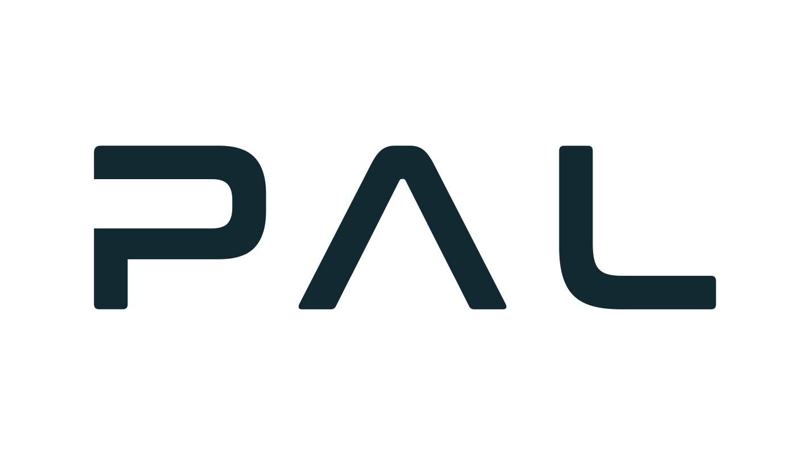

<!--
Copyright 2026 Intelligent Robotics Lab
SPDX-License-Identifier: Apache-2.0
-->

# EasyNav TIAGo Playground: description

The models of PAL Robotics' TIAGo and TIAGo Pro used by the EasyNav playgrounds: URDF, meshes and the ros2_control controllers. It depends neither on Gazebo nor on EasyNav: `easynav_playground_tiago_worlds` simulates it, and `easynav_playground_tiago` navigates with it.

## Build

From the ROS 2 workspace root:

```bash
rosdep install --from-paths src --ignore-src -r -y
colcon build --symlink-install --packages-up-to easynav_playground_tiago_description
source install/setup.bash
```

To get the URDF of TIAGo (`tiago.urdf.xacro`) or TIAGo Pro (`tiago_pro.urdf.xacro`):

```bash
xacro $(ros2 pkg prefix easynav_playground_tiago_description)/share/easynav_playground_tiago_description/urdf/tiago.urdf.xacro
```

## The TIAGo model

`urdf/tiago.urdf.xacro` is PAL's TIAGo description expanded once with PAL's default configuration: base `pmb2`, arm `tiago-arm` with wrist `wrist-2010`, force/torque sensor `schunk-ft`, end effector `pal-gripper`, laser `sick-571` and camera `orbbec-astra`. It was expanded from the Gazebo Harmonic ports of PAL's packages ([Tiago-Harmonic](https://github.com/Tiago-Harmonic): `tiago_robot` 29211f4, `pmb2_robot` a9c09d2, `pal_gripper` b6eec0f), and only the meshes it uses were copied. The controller values (`config/tiago_controllers.yaml`) come from PAL's `tiago_controller_configuration`, `pmb2_controller_configuration` and `pal_gripper_controller_configuration`.

Changes from PAL's model, for this simulation:

- The meshes and the controllers file point to this package.
- The head camera has a `gz_frame_id`: without it, its point cloud carried Gazebo's internal sensor name as frame.
- The wheels' velocity command limit is the wheel joint's (10.15 rad/s, 1 m/s) instead of 1 rad/s (0.1 m/s), which made the base crawl.
- The arm and torso start in PAL's `home` posture (`initial_value` in ros2_control), instead of tucking the arm with play_motion2 at startup.
- The wheels have a velocity state interface (initial value 0): without it, `gz_ros2_control` starts their velocity commands at NaN, which Gazebo rejects at every step until `diff_drive_controller` gets its first command or times out.

## The TIAGo Pro model

`urdf/tiago_pro.urdf.xacro` is PAL's TIAGo Pro description expanded once for Gazebo (`gazebo_version:=gazebo is_public_sim:=true`) with PAL's default configuration: omnidirectional base `omni_base` (four mecanum wheels) with two `sick-571` lasers at opposite corners, two `tiago-pro` arms with spherical wrist, tool changer and `pal-pro-gripper`, and head camera `realsense-d435`. It was expanded from PAL's `humble-devel` branches of [tiago_pro_robot](https://github.com/pal-robotics/tiago_pro_robot) (59593c6), [omni_base_robot](https://github.com/pal-robotics/omni_base_robot) (49ecf70), [tiago_pro_head_robot](https://github.com/pal-robotics/tiago_pro_head_robot) (a10e252), [pal_sea_arm](https://github.com/pal-robotics/pal_sea_arm) (efe6fab), [pal_pro_gripper](https://github.com/pal-robotics/pal_pro_gripper) (ed94457) and [pal_urdf_utils](https://github.com/pal-robotics/pal_urdf_utils) (e8600a3), plus `realsense2_description` from [realsense-ros](https://github.com/IntelRealSense/realsense-ros) (7a87097) for the camera frames; only the meshes it uses were copied. The controller values (`config/tiago_pro_controllers.yaml`) come from PAL's `omni_base_controller_configuration`, `tiago_pro_controller_configuration`, `tiago_pro_head_controller_configuration`, `pal_sea_arm_controller_configuration` and `pal_pro_gripper_controller_configuration`.

Changes from PAL's model, for this simulation:

- The meshes and the controllers file point to this package.
- The base is driven by ros2_controllers' `mecanum_drive_controller` (PAL's `omni_drive_controller` is not released), with PAL's wheel geometry and velocity limits; the wheels also export their velocity, which it reads.
- The wheels' friction is that of gz-sim's `mecanum_drive` example (`mu` 1.0 along the rollers' drive direction, `mu2` 0.0 across): with PAL's `mu2` 0.3 the wheels stalled when strafing.
- The gripper's mimic joints come from the URDF `<mimic>` tags (ros2_control), without PAL's gripper transmission plugin. Gazebo's physics engine warns once that it cannot create mimic constraints; `gz_ros2_control` moves those joints.
- The head camera renders `R8G8B8` images (Gazebo does not render `B8G8R8`).
- The arms and torso start in PAL's `home` posture (`initial_value` in ros2_control), arms tucked.
- The controller manager runs at 100 Hz, as TIAGo's, instead of 1000 Hz.

## Package layout

| Directory | Contents |
| --- | --- |
| `urdf/` | `tiago.urdf.xacro`, `tiago_pro.urdf.xacro` |
| `meshes/` | TIAGo: base (`pmb2/`), `tiago/` and the PAL gripper (`pal_gripper/`). TIAGo Pro: base (`omni_base/`), torso (`tiago_pro/`), head (`tiago_pro_head/`), arms (`pal_sea_arm/`), grippers (`pal_pro_gripper/`) and lasers (`pal_urdf_utils/`) |
| `config/` | ros2_control controllers (`tiago_controllers.yaml`, `tiago_pro_controllers.yaml`) |
| `doc/` | PAL Robotics logo |

## Authors and licensing

This package was put together by Francisco Martín Rico at the [Intelligent Robotics Lab](https://intelligentroboticslab.gsyc.urjc.es/) (Universidad Rey Juan Carlos), and is licensed under Apache-2.0; see [LICENSE](./LICENSE).

It includes third-party work under its own copyright and licenses:

- **The TIAGo robot model** (`urdf/`, `meshes/`) and the values of its controllers (`config/`) are the work of [PAL Robotics](https://pal-robotics.com/): Copyright (c) 2022-2024 PAL Robotics S.L. All rights reserved. They are licensed under the Apache License 2.0 (see [LICENSE](./LICENSE)), and come from PAL's [tiago_robot](https://github.com/pal-robotics/tiago_robot), [pmb2_robot](https://github.com/pal-robotics/pmb2_robot) and [pal_gripper](https://github.com/pal-robotics/pal_gripper), through their Gazebo Harmonic ports at [Tiago-Harmonic](https://github.com/Tiago-Harmonic). TIAGo is a robot by PAL Robotics.
- **The TIAGo Pro robot model** (`urdf/tiago_pro.urdf.xacro`, its meshes) and the values of its controllers (`config/tiago_pro_controllers.yaml`) are the work of [PAL Robotics](https://pal-robotics.com/): Copyright (c) 2024 PAL Robotics S.L. All rights reserved. They are licensed under the Apache License 2.0, and come from PAL's tiago_pro_robot, omni_base_robot, tiago_pro_head_robot, pal_sea_arm, pal_pro_gripper and pal_urdf_utils (links above). TIAGo Pro is a robot by PAL Robotics.
- **The head camera frames of TIAGo Pro** come from `realsense2_description`, in [realsense-ros](https://github.com/IntelRealSense/realsense-ros): Copyright 2023 RealSense, Inc., licensed under the Apache License 2.0.

The PAL Robotics logo below is PAL Robotics' own, used as published in its [brand guidelines](https://pal-robotics.com/es/guia-marca-logotipo/), unmodified.

<p align="center">
  <a href="https://pal-robotics.com/">
    <picture>
      <source media="(prefers-color-scheme: dark)" srcset="doc/pal_logo_white.svg">
      
    </picture>
  </a>
</p>
